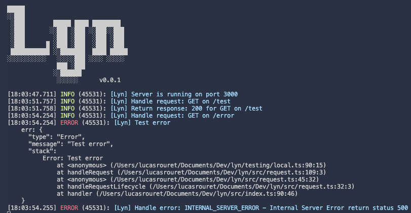

<h1 align="center">Lyn</h1>

<p align="center">
  <b>Type-safe APIs on Bun, without the setup.</b>
</p>

<p align="center">
  <a href="https://rouret.github.io/lyn/">Documentation</a> ·
  <a href="https://rouret.github.io/lyn/guide/getting-started">Getting started</a> ·
  <a href="CONTRIBUTING.md">Contributing</a>
</p>

Lyn is a small backend framework for [Bun](https://bun.sh). Chain your
routes, describe their inputs with [Zod](https://zod.dev), and get typed
handlers, request validation, consistent JSON errors and Postgres out of
the box.

It is made for proofs of concept, solo developers and agencies: a working,
safe API quickly, without assembling a stack first.

```ts
import { Lyn, z } from "lyn";

await new Lyn()
  .get("/", () => "Hello World")
  .post(
    "/users",
    ({ body }) => ({ message: `Hello ${body.name}` }),
    { body: z.object({ name: z.string() }) }
  )
  .listen(3000);
```



## Features

- **Typed handlers**: `body`, `params` and `query` are typed from your Zod schemas.
- **Validation**: invalid requests get a `400` before your handler runs.
- **One error format**: every error has the same JSON shape, and internal details never leak.
- **Checked configuration**: environment variables are validated and typed at startup.
- **Postgres built in**: pass a Drizzle schema, get a typed `db` in every handler.
- **Logs**: one line per request with a request id, JSON in production.
- **Tests without a server**: `app.handle(request)` runs a request in memory.

## Status

Lyn is at `0.0.1` and **not on npm yet**. It runs on Bun only, and its API
may still change. See [Getting started](https://rouret.github.io/lyn/guide/getting-started)
to use it from a clone.

## Roadmap

- [x] Routing, validation, errors
- [x] Environment variables
- [x] Logging
- [x] CORS
- [x] Postgres with Drizzle
- [x] Documentation
- [ ] CLI and migrations
- [ ] Authentication
- [ ] Example project
- [ ] Security checklist
- [ ] Publish to npm

## Contributing

See [CONTRIBUTING.md](CONTRIBUTING.md).

## Contact

[X @RouretLucas](https://x.com/RouretLucas)

## License

MIT
